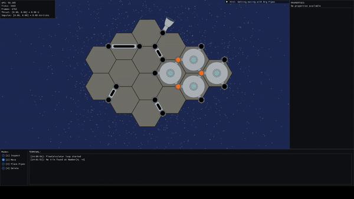
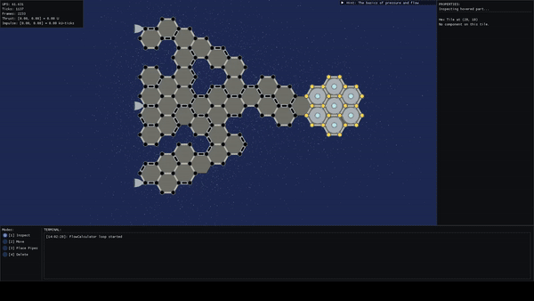
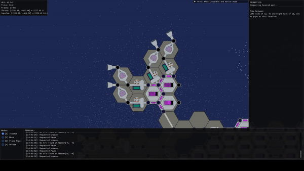

<div style="text-align:center; padding:18px 0 8px 0; border-radius:6px;">
  <h1 style="margin:0; font-size:2.2em; letter-spacing:0.6px;">Rocket Plumber</h1>
  <p style="margin:6px 0 8px 0; color:#555; font-size:1.05em;">A tech-demo for a rocket engine/spaceship fluid flow simulation game!</p>
  <p>
    <em style="color:#666">Built in Julia • Rendered with OpenGL</em>
  </p>
  <p>
    
  </p>
  <p>
    
  </p>
  <p>
    
  </p>
</div>

---
## Table of contents
- [Table of contents](#table-of-contents)
- [About The Project](#about-the-project)
- [Getting Started](#getting-started)
  - [Self-Contained Executables (The easy way!)](#self-contained-executables-the-easy-way)
  - [Running From Source (The hard way)](#running-from-source-the-hard-way)
    - [Launching from the terminal](#launching-from-the-terminal)
    - [Using the REPL and Revise](#using-the-repl-and-revise)
- [Future Plans](#future-plans)
- [Navigating the Codebase](#navigating-the-codebase)
  - [Execution Loops](#execution-loops)
    - [Calculator Loop](#calculator-loop)
    - [Game/Render Loop](#gamerender-loop)
  - [Reference Frames/Coordinate Systems](#reference-framescoordinate-systems)
  - [Creating and Solving of the MNA Matrices](#creating-and-solving-of-the-mna-matrices)
  - [The 'Component' System and its API](#the-component-system-and-its-api)
  - [Rendering Engine and Tools](#rendering-engine-and-tools)
- [Licence](#licence)

---
## About The Project

**Welcome to Rocket Plumber!** This is a tech demo for a space ship and rocket engine plumbing simulation I am hoping to use as the basis for a game. Currently I have the fluid mechanics implemented, along with a few of the components needed to build basic engines and get your ship moving. There is also a demo loop to teach you the basics and show off what you can currently do.

**Note:** this is NOT a full game. There isn't really a gameplay loop or goal yet. I started this project more to experiment with an idea I had for how you could implement a fluid system for a game. The setting (plumbing up rocket engines on a space ship) was just an interesting way to exercise this system. Eventually I had haphazardly put enough pieces together that I felt I had proven out that simulation, and if I was going to keep working on this, I needed to stop and actually figure out what the gameplay would be. Before doing that I decided to clean up and release the simulation as a demo so even if that effort dies out I will still have produced and released something I think is interesting.

The core of the simulation is a detailed fluid flow model, based on a circuit analogy for fluid flow in closed pipes. This means under the hood pumps are voltage sources, pipes are resistors, and the whole plumbing network is solved as if it's an electrical circuit. The algorithm I used for that is called Modified Nodal Analysis, which is just a formalism of some of the methods of DC circuit analysis you might have learnt in Circuits 101.

The whole demo was written in Julia, as it's a language I enjoy programming in. It has good linear algebra support, which was handy for the actual circuit simulation as the algorithm I used boils down to constructing and solving a big matrix. It's high level enough I can get things done quickly, but there's room to dig in and optimise for the parts of the code that need to run fast. The demo is displayed with a simple 2D sprite-based renderer built on OpenGL (through the `ModernGL.jl` bindings), with the UI built with `CImGui.jl`.

If you are looking for a full game I'd wait a bit, but if any of this sounds interesting I encourage you to download an executable and play around! Or if you're really keen even have a dig through the source code!

---
## Getting Started
### Self-Contained Executables (The easy way!)

If you are just interested in playing around, **I have built some stand-alone 'app' executables that can just be downloaded and run**. You will find those in the release assets on the right-hand side of the repository. Just download the one for your operating system!

**A bit of technical detail on the app executables you don't actually need:**

Julia is a JIT compiled language, and generally you are supposed to have Julia installed to run Julia code. I have produced these executables using tools that effectively package my code with a Julia environment to run it, so the executables are a bit larger than I would like (although there's a lot of ongoing work in this space I haven't fully leveraged). Due to some pre-compilation baked into this process, the demo ends up loading and running better in this format than loading from source!

### Running From Source (The hard way)
**Note:** I have written this to be more friendly towards those unfamiliar with Julia, so a lot of these steps are not particularly specific to this project. If you have issues or you want more details, there are more generic introductions you might find useful ([like this](https://docs.julialang.org/en/v1/manual/getting-started/)), or ask your AI of choice!

#### Launching from the terminal
To run the game from source you will need:

- An up-to-date installation of Julia which can be acquired by following the instructions [here](https://julialang.org/install/).
- A copy of the code, just clone this repository!

Once you have these run this command from the root folder to set up the required external dependencies (you only have to do this once):

```bash
julia --project=. -e 'using Pkg; Pkg.instantiate()'
```

From here you are ready to run! Start the demo with this command:

```bash
julia --project=. --threads=3 src/repl_launch.jl
```

#### Using the REPL and Revise

If you are serious about making changes to the code I would recommend using the REPL for your development. The best source for this is [the Julia manual section on it](https://docs.julialang.org/en/v1/stdlib/REPL/), but I'll give a TLDR:

You might notice Julia seems to take a while to start up, and that the demo seems to take a while to load. This is primarily because of the way Julia works. The first time it sees a function, it JIT compiles, but for subsequent calls it uses a cache of the compiled code to speed things up. To leverage this for your development, you want to keep the Julia session running as long as you can, to minimise how often you have to recompile things. This is what the REPL does, it lets you evaluate sections of code interactively while keeping the session open!

To start the REPL in the project's environment run:

```bash
julia --project=. --threads=3
```

Then to run the launch script just include it:

```julia
include("src/repl_launch.jl")
```

Now when you exit the demo, your Julia REPL session should remain open!

On its own this isn't that useful as you would need to restart the Julia session if you make changes to the code, but thankfully this project includes the [Revise.jl](https://timholy.github.io/Revise.jl/stable/) package. This package watches for changes in your source files and re-compiles modified functions as required, without requiring a restart of the Julia session. Now you can leave your REPL session open, make changes to the code, run the `repl_launch` script, and your changes should take effect automatically (with some [limitations](https://timholy.github.io/Revise.jl/stable/limitations/)).

I actually don't use the REPL much directly from the command line. I'd recommend working in VS Code with the Julia extension, where you can run scripts in the REPL just by pressing the 'run' button. This repository already includes the appropriate `.vscode` settings to ensure the REPL launches with the right number of threads!

---
## Future Plans

As mentioned, I plan to continue development based on this demo and try and produce a full game.

For the simulation I already have a list of ideas I want to add:

- A bunch more fuel types and engines including bi-propellants, ion drives, and nuclear thermal engines. I'd also like to make the options for engine cycles more flexible
- An electricity system, building upon the basic energy stores with multiple generation methods. These will allow electric pumps to be recharged, and open whole new possibilities.

But I am going to hold off on adding more features until I have figured out where they will fit in an actual gameplay loop. The game concept is much more in flux. I have some ideas like:

- I want to require manoeuvres to be performed where both bulk delta-V from large engines, and small precise thrust from small engines are valuable, to allow a larger variety of engines to remain useful.
- I want ship parts to be scavenged or bought rather than crafted, as I feel like inventory and crafting systems are a bit overdone. I like the idea that you might have to build your ship around what you get rather than exactly what you want (think what weapons you end up with on a run of FTL)

Beyond this I am still unsure what the final game will look like (and even these are not set in stone) so stay tuned! If you have any thoughts or ideas feel free to pass them on!

Development is likely to move pretty slowly as this is a hobby project. To get it to this point has already taken over a year of on-off development, and the amount of energy I have to write code for fun is inconsistent as it depends on the amount of code I have to write at work. I intend to continue posting the updates to this repo, even if they are infrequent. I won't share every commit, but I plan to push out changes in large releases as it makes sense.

---
## Navigating the Codebase

The source code is broken up into 2 main places:

- Scripts in `/src`
- Local development packages in `/local_packages`

I generally use packages for relatively self-contained code with well-defined interfaces (ideally most of the code), and scripts for the program navigation, the main window, and user interaction.

### Execution Loops

If you are looking for the code that's actually 'running' there are 2 main loops, each running on an independent thread.

#### Calculator Loop

The calculator loop is responsible for performing the heavy simulation updates. You'll find it in the package `HexFlowCalculator` in `/local_packages`. It owns the authoritative versions of the game map, and will use that map to construct a modified nodal analysis matrix of the plumbing/circuit, based on the circuit elements returned by the components in the game map. This loop also solves the MNA, working out the output voltage/pressures and currents/flows. The actual method implementation of the MNA and the necessary steps to prepare the elements live in the `FlowEngine` package.

The calculator loop is the only place where modifications to the map occur. User-facing code produces map edit commands and pushes them to a channel where they can be consumed by the calculator loop which validates them and applies them.

After each iteration the calculator publishes a snapshot of the map, and the output state of the MNA via a deep copy. This can be accessed in a thread-safe way by the game loop. This is not an optimised approach to this, but it's simple and so far has not been a bottleneck at all.

The calculator loop currently targets a fixed rate of 60 UPS, but this could slip without affecting the frame rate of the game/render loop.

#### Game/Render Loop

The game loop handles the rendering of the game map and the UI. You'll find it in the `src/gameloop.jl` script. It pulls a copy of the latest available snapshot of the game map and uses this for everything.

The rendering is performed in stages to ensure correct render heights. First the background particle effects are rendered. Then all of the sprites are rendered. This is done by first collecting rendering commands from various sources into a render queue. This queue is first sorted by render height, and then by various attributes so as to minimise the required OpenGL state changes. The sorted queue is then rendered in one shot. A set of foreground particles is then rendered. Finally the UI elements are rendered with CImGui.

User inputs are also handled in this loop. These can affect rendering-only things like the viewport directly, but any desired map edits are converted into edit commands to be handled by the calculator loop.

This loop currently targets running in vsync and thus will match the frame rate of your monitor. As previously mentioned, frame rate doesn't impact simulation speed as the calculator loop runs independently at 60 UPS.

### Reference Frames/Coordinate Systems

The game fundamentally operates on a hexagonal grid, stored using an axial coordinate system ([see here for a good explanation](https://www.redblobgames.com/grids/hexagons/#coordinates-axial)), with various custom coordinate types used.

A floating point number can be used to represent an arbitrary point in this coordinate system and that is typed as an `AxialCoord`. Integer coordinates in this space correspond to a specific hexagonal tile on the map, and these are typed as a `TileCoord`. They can both of course be converted to Cartesian space, or a `CartesianCoord`, and this is often required for actual rendering.

A number of other map elements have coordinate systems defined for them. The corners of the hexagonal tiles (used as the pressure nodes) are stored as a `VertexCoord` which combines a `TileCoord` and a direction. This is not a unique representation so the concept of a 'proper' vertex was introduced, where the only allowable directions are `Q_POS` and `Q_NEG` (left and right). There is only one 'proper' representation for a given vertex.

The edges between hexagonal tiles (used for the pipes) are stored as an `EdgeCoord` which consists of the 2 `NodeCoord`s it spans. This is a similarly non-unique representation, so a 'proper' edge is defined as consisting of proper vertexes, and ordered so the vertexes span from left to right. There is only one 'proper' representation for a given edge.

These coordinate system types are all defined in `local_packages/HexFrame`. This was one of the earliest parts of the code I wrote, so there is a lot in here that is suboptimal.

A set of types is also used to describe the nodes to which circuit elements can connect on which the flow physics are based. For the purposes of the circuit analysis the node can exist either on vertexes of a hexagon/tile, on a special 'internal' node for each tile, or be a connection to the global 'ground' node. These options are enumerated in a `NodePos` which exists relative to a specific tile. A `NodeCoord` on the other hand is absolute, and is defined by a `NodePos` and the `TileCoord` it is relative to. Again to avoid non-uniqueness problems a 'proper' node coordinate is defined as one where its `NodePos` is either `Q_POS`, `Q_NEG` (left and right), or the special internal or ground node.

The circuit elements themselves are defined by their type and value, and then their connections. For elements intended to be relative to a tile (like those a component produces as it is unaware of its location on the map) they are typed as a `RelativeElement` and use 2 `NodePos`s to define a set of `RelativeElementConnections`. For elements whose position is absolute (like those used in the MNA) they are typed as an `AbsoluteElement` and use 2 `NodeCoord`s to define a set of `AbsoluteElementConnections`.

These element types are defined in `local_packages/HexElements`.

This is fundamentally how the simulation relates positions in the hexagonal grid, to the abstract nodes and elements used in MNA.

### Creating and Solving of the MNA Matrices

First all of the circuit elements are collected into a big list from the various sources that produce them like tiles and maps. This list is then 'pruned' to remove unnecessary dead branches that don't connect to anything, by iteratively removing elements whose nodes don't connect to anything else. Elements are then further filtered by performing graph traversal from ground nodes and removing any elements unconnected to ground in any way, as these will have an undefined pressure and will not contribute to flow. Finally 'dangling dependants' are removed, which are dependant elements (like current-dependant current sources etc.) whose dependent element doesn't exist as it was filtered in a previous step. If any elements are removed in this last step, the whole process must be repeated as new dead or grounded branches could have been created.

The remaining element list is used to construct the MNA matrices. I won't go into too much detail on the MNA algorithm, it's well documented by people who actually understand it ([like here](https://qucs.sourceforge.net/tech/node14.html)). The output is a system of equations represented as matrices that can be solved to determine the node voltages (the pressures) and the current (flows) through the elements.

### The 'Component' System and its API

If you are looking to add a new tile type, you will need to create a concrete instance of the `ComponentBehavior` abstract type. There is an interface assumed to be implemented for all instances of this type, which can be found in `local_packages/components/HexComponentsAPI`. There are a set of 'mandatory' methods that you must implement for the type. These include producing the circuit elements required for MNA, the tuning interface, and a basic rendering method. There are also a set of 'optional' methods. These have suitable default methods (usually ones that do nothing) defined for `ComponentBehavior` so you do not need to implement these. You will likely need to implement some of these for more complex parts if you want dynamic state updating, user click behaviours, fluid type interactions, animated rendering, or particle effects. There is a similar but simpler interface defined for pipe types also.

Actual components are defined in various other packages in `local_packages/components`. The methods that will be implemented from the `HexComponentsAPI` need to be explicitly imported so they can be extended. Code sharing for components is done through composition. An informal 'behaviour fragment' can be defined that implements a subset of the interface methods. You can then construct a full `ComponentBehavior` by compositing multiple behaviour fragments, as well as direct method implementation. Delegation of methods to inner behaviour fragments is handled with multiple dispatch and a delegation function, for instance `on_click!` on a switched nozzle might be intended to interact with an internal switch behaviour fragment, so a delegation is defined so that:

```julia
on_click!(comp::SwitchedNozzleCompBehav) = on_click!(comp.switch)
```

The component system makes extensive use of keyword arguments, and specifically `kwargs...` which allows delegation functions to pass all keyword arguments transparently. This allows a new keyword argument to be added to a method call, and any existing implementations that don't require that argument will continue working without issue.

### Rendering Engine and Tools

Rendering for this demo is done with OpenGL in a GLFW context, but a set of wrapper types has been defined and utility functions have been defined in `local_packages/RenderEngine`. The logic in `RenderEngine` is designed to be non-specific to this demo, as a matter of good practice. If there is interest this could potentially be broken out into its own package, so other people could use it.

Wrapper types were created for all the IDs of OpenGL objects that are normally just a `GLuint` so they can be brought into Julia's type system for type safety and dispatch. Sufficient `convert` methods are provided so no additional verbosity is needed when interacting with `ModernGL` bindings. A multiple-dispatch driven function `wglUniform` is provided for uniform binding that dispatches to an appropriate `glUniform3f` call based on the argument type.

A set of helper functions are provided to create, bind, and manage OpenGL objects using the defined types. Programs can be created by providing shader source. Both static and dynamically updated VAOs can be created, based with attribute layout inferred from a format struct including the type and the number of elements. Textures and UBOs are also supported.

Render programs can be defined that link in the expected uniform formats and allow `RenderCommand` to be constructed automatically for deferred rendering. This allows render commands to be collected out of order in the game logic, and then sorted based on desired render height, and on attributes so that OpenGL state changes are minimised.

A data structure which tracks all of the OpenGL objects instantiated in state are stored in the `GLObjectMap` which allows OpenGL IDs and other characteristics saved at creation to be looked up based on a name `Symbol`, so code can reference objects it expects to be instantiated without creating direct dependencies.

A type is also defined for 'sprites' even though sprites are not a part of OpenGL directly. This is an additional abstraction I have added to allow specific sprites to be referenced by name symbol, and they refer to a specific location in a large sprite atlas texture. This is loaded as a PNG file, and as a JSON file which defines what named sprites are included and where to find them.

A tool is provided in `tools/TexturePacker` which takes a folder full of individual sprites and packs them into an atlas and the corresponding JSON file. This packer also removes blank space from the edges of the sprites, but remembers the location offset to allow the relative location of sprites to be preserved while reducing the final atlas size.

---
## Licence
 
This code is NOT open source. Copyright is retained but a narrow personal-use exemption is provided, which is intended to allow:
- downloading, viewing and running the code
- making modifications for personal experimentation (but not distributing them)

I chose this approach so that I could still try and sell a game based on this in the future if things go well. Releasing the code publicly in this limited way meets my goal of letting people read and play with it. I am not really expecting contributions, or direct forks/derivatives.

If there is interest in broader use, I am open to changing this especially for local packages that could be released as separate fully open-source packages. In particular, the RenderEngine, due to its relatively project‑agnostic nature, could be useful to others working with OpenGL in Julia. Let me know if there is a desire for this!